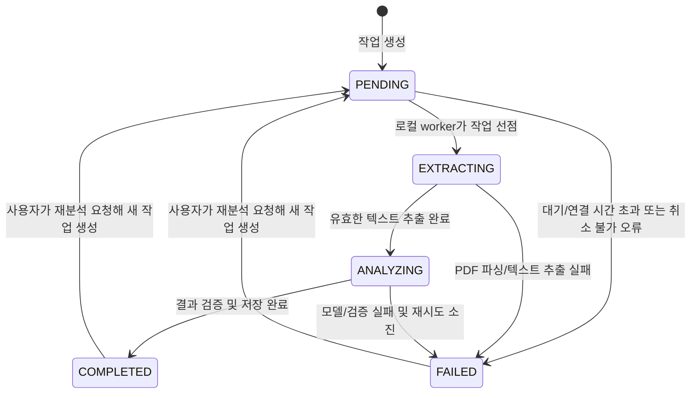

# AI 분석 파이프라인

## 처리 구조

```text
Spring Boot
  -> 인증된 보안 터널
    -> FastAPI 작업 접수
      -> PyMuPDF 텍스트 추출
        -> 페이지/청크 전처리
          -> Ollama 순차 추론
        -> 구조 검증 및 계층적 통합
  <- 구조화된 분석 결과
<- PostgreSQL 작업 상태/결과 저장
```

- Spring Boot는 사용자 인증, 문서 소유권, 작업 생성, 상태와 결과 영속화를 담당한다.
- FastAPI는 내부 작업 ID를 받아 승인된 Storage 객체를 임시로 가져오거나 Spring Boot가 제공하는 단기 접근 수단으로 PDF를 읽는다. 장기 자격 증명을 요청 본문에 넣지 않는다.
- PyMuPDF는 페이지별 텍스트와 페이지 번호를 추출한다.
- Ollama는 로컬 추론만 수행하며 외부에서 직접 호출할 수 없다.

## 상태 전이



- 상태는 전진 방향으로만 갱신하고 재분석은 기존 행을 되돌리지 않고 새 `analysis_jobs` 행을 만든다.
- 상태 갱신은 예상 이전 상태를 조건으로 한 원자적 compare-and-set으로 처리한다.
- `COMPLETED`와 `FAILED`는 종료 상태다. `COMPLETED`에는 정확히 하나의 검증된 결과가 있어야 한다.
- 실패 작업의 안전한 코드와 메시지를 보존하되 내부 예외와 모델 원문은 저장하지 않는다.

## 작업 접수와 중복 방지

1. Spring Boot가 문서 소유권과 업로드 검증 완료 여부를 확인한다.
2. 클라이언트의 `Idempotency-Key`와 서버 계산 요청 fingerprint를 검증한다.
3. 같은 키와 같은 fingerprint면 기존 작업을 반환한다. 같은 키에 다른 fingerprint면 `409 Conflict`를 반환한다.
4. 문서에 활성 상태(`PENDING`, `EXTRACTING`, `ANALYZING`) 작업이 있으면 새 작업을 만들지 않고 기존 작업을 반환한다.
5. DB 부분 UNIQUE 인덱스로 경합 상황에서도 문서당 활성 작업 하나를 보장한다.
6. FastAPI도 작업 ID를 멱등 키로 사용하고 이미 처리 중이거나 완료된 작업을 중복 실행하지 않는다.

## 텍스트 추출

- 파일 크기, PDF 시그니처, 암호화 여부, 페이지 수를 확인한다.
- PyMuPDF로 1부터 시작하는 페이지 번호와 정규화된 텍스트를 추출한다.
- 빈 페이지는 기록하되, 문서 전체에 유효한 텍스트가 없으면 `SCANNED_PDF_UNSUPPORTED`로 실패 처리한다.
- 손상·암호화·지원 불가 PDF는 안전한 실패 코드로 변환한다. OCR은 MVP 범위 밖이다.
- 추출 텍스트 총량, 페이지당 글자 수, 처리 시간과 메모리에 상한을 둔다.

## 장문 PDF와 계층적 요약

1. 추출된 텍스트를 페이지 경계를 보존한 채 모델 컨텍스트보다 작은 청크로 나눈다.
2. 가능한 경우 문단 경계에서 분할하고 각 청크에 원본 페이지 범위를 붙인다.
3. 각 청크를 순차적으로 요약해 후보 핵심 포인트와 키워드, 출처 페이지를 만든다.
4. 청크 결과만 다시 입력해 문서 전체 요약과 중복 제거된 포인트/키워드를 생성한다.
5. 최종 결과를 JSON Schema로 검증하고 출처 페이지가 실제 범위 안인지 확인한다.

청크 크기, 겹침 크기, 최대 생성 토큰과 프롬프트는 선택 모델의 컨텍스트 길이 및 VRAM 측정 후 확정한다. 추출한 PDF 원문을 외부 모델로 전송하지 않는다.

## 결과 구조와 근거

- 핵심 요약: 전체 문서의 짧은 요약과 근거 페이지 목록
- 주요 포인트: 항목별 문장과 하나 이상의 근거 페이지
- 키워드: 정규화된 용어와 등장/근거 페이지
- 경고: 처리 제약과 AI 결과 검토 안내
- 재현 정보: 모델 이름과 파이프라인 버전

상세 JSONB 형식은 [데이터 모델](ERD.md#분석-결과-jsonb-구조)을 따른다. 페이지는 근거 위치를 안내하지만 생성 내용의 사실성을 보장하지 않는다. UI에는 “AI 생성 결과로 오류나 누락이 있을 수 있으므로 중요한 내용은 원문 페이지에서 확인해야 한다”는 고지를 표시한다.

## 오류 처리와 재시도

| 오류 | 처리 |
|---|---|
| 보안 터널 연결 실패/PC 종료 | 짧은 연결 재시도 후 작업을 안전하게 `FAILED` 처리하고 재분석 안내 |
| PDF 다운로드 실패 | 만료된 단기 접근 수단을 제한적으로 갱신; 권한 오류는 재시도하지 않음 |
| 손상 또는 암호화 PDF | 즉시 `FAILED`; 지원 형식 안내 |
| 텍스트 없는 스캔 PDF | `FAILED`; OCR 미지원 안내 |
| PyMuPDF 일시 오류 | 동일 입력에 제한된 재시도 후 실패 |
| Ollama 시간 초과/일시 오류 | 지수 backoff와 제한된 재시도; 중복 생성 금지 |
| 모델 응답 JSON/스키마 오류 | 교정 프롬프트로 제한된 재시도 후 실패 |
| 저장 경합/일시 DB 오류 | 멱등 작업 ID로 제한된 재시도 |

- 기본 횟수와 시간은 코드 상수로 숨기지 않고 설정으로 관리하되 상한을 둔다.
- 전체 작업 deadline과 단계별 timeout을 구분한다. timeout 이후 돌아온 늦은 결과는 현재 작업 상태와 lease를 확인한 뒤 폐기한다.
- 재시도 가능/불가능 오류 분류, 최대 횟수 및 실제 시간은 성능 시험 후 확정한다.

## 단일 GPU 실행 제어

- FastAPI 쪽에 동시 Ollama 추론 수 1인 큐/worker를 둔다.
- DB 작업을 선점할 때 `lease_owner`, `lease_expires_at`, `heartbeat_at`을 원자적으로 갱신한다. PC 재시작 또는 heartbeat 중단 후 만료된 lease만 다른 worker가 재선점한다.
- `deadline_at`, `retry_count`, `max_retries`, `next_retry_at`으로 전체 timeout과 자동 재시도 상한을 영속화해 프로세스 재시작 후에도 동일한 정책을 유지한다.
- 텍스트 추출과 모델 추론의 동시 실행도 메모리 측정 결과에 따라 제한한다.
- 대기열 길이와 예상 대기 시간을 상태 응답에 노출할 수 있지만 확정되지 않은 완료 시간을 보장하지 않는다.

## PC 및 터널 장애 복구

- PC나 터널이 내려가 있으면 Spring Boot는 무한 대기하지 않고 빠르게 실패하거나 제한된 대기 정책을 적용한다.
- 처리 중 연결이 끊기면 lease/heartbeat 만료 후 작업을 회수하고, 최대 재시도 이내에서만 다시 실행한다.
- 로컬 처리 재개 시 서버에서 활성 작업 상태를 확인해 이미 종료된 작업의 결과를 덮어쓰지 않는다.
- 사용자는 안전한 장애 메시지와 재분석 동작을 제공받는다. 자동 재시도와 사용자 재분석이 동시에 발생해도 DB 유일성 제약으로 하나만 실행한다.

## 검증 필요

- 사용할 Ollama 모델, 컨텍스트 길이, 출력 JSON 준수율
- 사용자 Windows PC의 VRAM/RAM과 30페이지 PDF 처리 시간
- 청크 크기, 계층적 요약 품질 및 근거 페이지 정확도
- 단계별/전체 timeout, 재시도 횟수와 backoff
- lease 길이, heartbeat 주기와 로컬 큐 polling 간격
- 터널 장애 시 허용할 대기 시간과 사용자 경험
