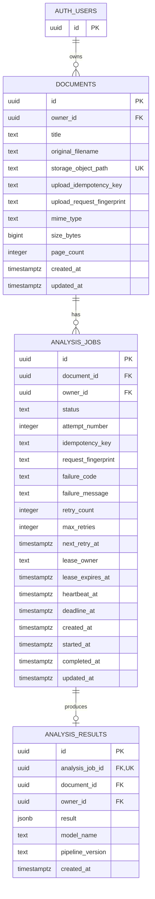

# DocuMind AI 데이터 모델

## 설계 원칙

- `auth.users`의 UUID를 문서 소유권의 기준으로 사용한다.
- `documents`는 원본 PDF의 메타데이터와 비공개 Storage 객체 경로를 보관한다.
- `analysis_jobs`는 최초 분석과 재분석을 모두 불변 이력으로 기록한다.
- `analysis_results`는 성공한 작업당 하나의 구조화된 결과를 보관한다.
- 모든 API 조회는 인증된 사용자 ID와 `owner_id`를 함께 조건으로 사용한다. 클라이언트가 전달한 사용자 ID는 신뢰하지 않는다.

## 관계



Mermaid의 `AUTH_USERS`는 Supabase의 `auth.users`를 나타낸다. 실제 스키마 이름은 `auth.users`이며 애플리케이션 테이블은 `public` 스키마에 둔다.

## 테이블 정의

### `auth.users` (Supabase 관리)

| 컬럼 | 타입 | 제약조건 | 설명 |
|---|---|---|---|
| `id` | `uuid` | PK, NOT NULL | Supabase Auth 사용자 식별자 |

이 테이블의 계정·자격 증명 컬럼은 Supabase가 관리한다. 애플리케이션은 `id`만 외래 키로 참조하고 인증 정보를 복제하지 않는다.

### `public.documents`

| 컬럼 | 타입 | 제약조건 | 설명 |
|---|---|---|---|
| `id` | `uuid` | PK, NOT NULL, 기본값 `gen_random_uuid()` | 문서 식별자 |
| `owner_id` | `uuid` | NOT NULL, FK → `auth.users(id)` ON DELETE CASCADE | 문서 소유자 |
| `title` | `text` | NOT NULL, 길이 1~200 | 사용자 편집 가능 제목 |
| `original_filename` | `text` | NOT NULL, 길이 1~255 | 표시용 원본 파일명. 경로로 사용하지 않음 |
| `storage_object_path` | `text` | NOT NULL, UNIQUE | private bucket 객체 경로. `{owner_id}/{document_id}/source.pdf` 형식 권장 |
| `upload_idempotency_key` | `text` | NOT NULL, 길이 1~128 | 업로드 재전송을 같은 문서로 수렴시키는 키 |
| `upload_request_fingerprint` | `text` | NOT NULL | 파일 SHA-256과 정규화한 제목 등으로 서버가 계산한 요청 지문 |
| `mime_type` | `text` | NOT NULL, CHECK `application/pdf` | 서버가 판별한 MIME 타입 |
| `size_bytes` | `bigint` | NOT NULL, CHECK `1..10485760` | 초기 정책상 최대 10MB |
| `page_count` | `integer` | NOT NULL, CHECK `1..30` | 안전한 파싱 후 확정된 페이지 수 |
| `created_at` | `timestamptz` | NOT NULL, 기본값 `now()` | 생성 시각 |
| `updated_at` | `timestamptz` | NOT NULL, 기본값 `now()` | 제목 등 변경 시 갱신 |

UNIQUE (`owner_id`, `upload_idempotency_key`)를 두고 같은 키의 fingerprint가 같으면 기존 문서를, 다르면 충돌을 반환한다. 또한 UNIQUE (`id`, `owner_id`)를 두어 하위 테이블의 복합 외래 키가 문서와 소유자를 함께 참조하게 한다. `page_count`가 30을 초과하거나 기본 텍스트 감지에 실패하면 업로드 사전검사를 완료하지 않고 Storage 객체와 DB 레코드를 정리한다. 전체 텍스트 추출은 분석의 `EXTRACTING` 단계에서 다시 검증한다.

### `public.analysis_jobs`

| 컬럼 | 타입 | 제약조건 | 설명 |
|---|---|---|---|
| `id` | `uuid` | PK, NOT NULL, 기본값 `gen_random_uuid()` | 작업 식별자 |
| `document_id` | `uuid` | NOT NULL, FK → `documents(id)` ON DELETE CASCADE | 대상 문서 |
| `owner_id` | `uuid` | NOT NULL, FK → `auth.users(id)` ON DELETE CASCADE | RLS와 소유권 조회를 위한 소유자 |
| `status` | `text` | NOT NULL, CHECK 허용 상태, 기본값 `PENDING` | `PENDING`, `EXTRACTING`, `ANALYZING`, `COMPLETED`, `FAILED` |
| `attempt_number` | `integer` | NOT NULL, CHECK `>= 1` | 문서별 분석 시도 순번 |
| `idempotency_key` | `text` | NOT NULL, 길이 1~128 | 동일 사용자 요청 중복 방지 키 |
| `request_fingerprint` | `text` | NOT NULL | 문서 ID와 분석 옵션의 서버 계산 해시 |
| `failure_code` | `text` | NULL | 안정적인 내부/클라이언트용 실패 분류 코드 |
| `failure_message` | `text` | NULL | 비밀정보와 내부 예외를 제거한 사용자 메시지 |
| `retry_count` | `integer` | NOT NULL, 기본값 0, CHECK `>= 0` | 같은 작업 안에서 수행한 자동 재시도 횟수 |
| `max_retries` | `integer` | NOT NULL, CHECK `>= 0` | 작업 생성 시 고정한 자동 재시도 상한 |
| `next_retry_at` | `timestamptz` | NULL | backoff 후 다시 처리할 수 있는 시각 |
| `lease_owner` | `text` | NULL | 작업을 선점한 내부 worker 식별자 |
| `lease_expires_at` | `timestamptz` | NULL | 중단 작업 회수를 위한 lease 만료 시각 |
| `heartbeat_at` | `timestamptz` | NULL | worker의 마지막 생존 신호 시각 |
| `deadline_at` | `timestamptz` | NOT NULL | 전체 작업의 절대 처리 기한 |
| `created_at` | `timestamptz` | NOT NULL, 기본값 `now()` | 요청 접수 시각 |
| `started_at` | `timestamptz` | NULL | 처리 시작 시각 |
| `completed_at` | `timestamptz` | NULL | 성공 또는 최종 실패 시각 |
| `updated_at` | `timestamptz` | NOT NULL, 기본값 `now()` | 상태 갱신 시각 |

추가 제약조건:

- UNIQUE (`owner_id`, `idempotency_key`): 같은 사용자의 같은 요청 키를 한 작업으로 수렴시킨다.
- UNIQUE (`document_id`, `attempt_number`): 시도 순번 충돌을 방지한다.
- UNIQUE (`id`, `document_id`, `owner_id`): 결과 테이블이 작업·문서·소유자를 하나의 복합 외래 키로 참조하게 한다.
- 부분 UNIQUE 인덱스 (`document_id`) WHERE `status IN ('PENDING', 'EXTRACTING', 'ANALYZING')`: 문서당 활성 작업을 하나로 제한한다.
- FOREIGN KEY (`document_id`, `owner_id`) REFERENCES `documents(id, owner_id)` ON DELETE CASCADE: 작업의 소유자를 대상 문서 소유자와 DB 수준에서 일치시킨다. 별도의 `owner_id` → `auth.users(id)` 외래 키는 중복 경로를 피하기 위해 두지 않는다.
- `COMPLETED`, `FAILED`에서만 `completed_at`을 요구하고 `FAILED`에서만 실패 필드를 허용하는 CHECK 제약을 둔다.
- `retry_count <= max_retries`, `deadline_at > created_at` CHECK를 둔다. 활성 worker가 있는 동안 세 lease 필드는 함께 존재하도록 제약하고, 만료 여부 판단과 원자적 재선점은 트랜잭션 쿼리로 처리한다.

### `public.analysis_results`

| 컬럼 | 타입 | 제약조건 | 설명 |
|---|---|---|---|
| `id` | `uuid` | PK, NOT NULL, 기본값 `gen_random_uuid()` | 결과 식별자 |
| `analysis_job_id` | `uuid` | NOT NULL, UNIQUE | 성공한 작업과 1:1 관계 |
| `document_id` | `uuid` | NOT NULL | 문서별 결과 이력 조회용 |
| `owner_id` | `uuid` | NOT NULL | RLS와 소유권 조회용 |
| `result` | `jsonb` | NOT NULL, CHECK JSON object | 구조화된 AI 결과 |
| `model_name` | `text` | NOT NULL | 사용 모델 식별자. 비밀값 아님 |
| `pipeline_version` | `text` | NOT NULL | 프롬프트/파서 버전 |
| `created_at` | `timestamptz` | NOT NULL, 기본값 `now()` | 결과 저장 시각 |

FOREIGN KEY (`analysis_job_id`, `document_id`, `owner_id`) REFERENCES `analysis_jobs(id, document_id, owner_id)` ON DELETE CASCADE를 사용한다. 이 복합 외래 키와 `analysis_job_id` UNIQUE가 작업·문서·소유자의 일치 및 작업당 결과 최대 하나를 DB 수준에서 보장한다. 결과 저장과 작업의 `COMPLETED` 전환은 하나의 트랜잭션으로 처리한다. 삭제 경로는 `auth.users` → `documents` → `analysis_jobs` → `analysis_results` 하나로 유지한다.

## 분석 결과 JSONB 구조

```json
{
  "schemaVersion": "1.0",
  "summary": {
    "text": "문서 전체 핵심 요약",
    "sourcePages": [1, 2]
  },
  "keyPoints": [
    {
      "text": "주요 포인트",
      "sourcePages": [2]
    }
  ],
  "keywords": [
    {
      "term": "키워드",
      "sourcePages": [1, 3]
    }
  ],
  "warnings": ["AI 생성 결과는 원문 확인이 필요합니다."]
}
```

검증 규칙:

- `schemaVersion`, `summary`, `keyPoints`, `keywords`, `warnings`를 필수로 한다.
- 페이지 번호는 1부터 시작하며 `documents.page_count` 이하여야 한다.
- 키워드 검색에는 `keywords[*].term`만 사용하고 생성된 자유 문장을 권한 판단에 사용하지 않는다.
- JSON Schema 검증에 실패한 모델 응답은 결과로 저장하지 않고 제한된 재시도 후 작업을 `FAILED`로 전환한다.

## 삭제와 보존

- 사용자 삭제: `auth.users` → `documents` → `analysis_jobs`/`analysis_results`를 CASCADE 삭제한다. 비공개 Storage 객체는 DB 외부 자원이므로 별도 서버 작업으로 삭제하고 실패를 추적한다.
- 문서 삭제: 먼저 소유권을 확인한 뒤 Storage 객체 삭제와 DB 삭제를 조정한다. DB 삭제 시 작업과 결과는 CASCADE 삭제한다.
- 작업 이력: 문서가 존재하는 동안 완료/실패 이력을 보존한다. 개별 작업 결과만 임의 삭제하는 공개 API는 제공하지 않는다.
- DB와 Storage의 원자적 트랜잭션은 불가능하므로 보상 삭제와 고아 객체 정리 작업을 설계한다.

## 인덱스

| 인덱스 | 목적 |
|---|---|
| `documents(owner_id, created_at DESC, id DESC)` | 기본 목록과 안정적인 정렬 |
| `documents(owner_id, updated_at DESC, id DESC)` | 수정일 정렬 |
| `documents(owner_id, lower(title), id)` | 대소문자 비구분 제목 정렬과 안정적인 tie-break |
| `documents(owner_id, lower(title) text_pattern_ops)` | 제목 prefix 검색 |
| `analysis_jobs(document_id, created_at DESC, id DESC)` | 분석 이력 |
| `analysis_jobs(owner_id, status, created_at DESC)` | 사용자별 상태 필터 |
| `analysis_jobs(document_id) WHERE status IN (...)` UNIQUE | 활성 분석 중복 실행 방지 |
| `analysis_jobs(status, next_retry_at, created_at) WHERE status = 'PENDING'` | 순차 worker의 처리 가능 작업 선점 |
| `analysis_jobs(lease_expires_at) WHERE status IN ('EXTRACTING', 'ANALYZING')` | 만료 lease와 중단 작업 회수 |
| `analysis_results(document_id, created_at DESC)` | 최신/과거 결과 조회 |
| `analysis_results USING GIN ((result -> 'keywords'))` | JSONB 키워드 검색 보조 |

MVP의 `q` 검색은 대소문자를 무시한 제목 prefix 또는 정규화된 키워드 정확 일치로 정의한다. 제목 부분 문자열 검색이 필요하면 `pg_trgm` 확장과 `GIN (lower(title) gin_trgm_ops)` 도입을 검증한다. 키워드 검색의 정확성·성능이 부족하면 MVP 이후 정규화 테이블을 검토하며, 현재 단계에서 RAG나 벡터 검색을 도입하지 않는다.

## 접근 제어와 RLS 책임

- Spring Boot는 공개 API의 1차 권한 경계다. JWT의 검증된 `sub`를 `owner_id`로 사용하고 모든 조회·변경에서 소유권을 확인한다.
- RLS는 SQL/REST 접근 실수에 대한 심층 방어다. 사용자 JWT 컨텍스트로 접근할 때 `owner_id = auth.uid()`인 행만 SELECT/INSERT/UPDATE/DELETE하도록 정책을 둔다.
- `analysis_jobs`와 `analysis_results`도 동일한 직접 `owner_id` 조건을 사용하며, INSERT 시 연결된 문서 소유권까지 검증한다.
- service role은 RLS를 우회할 수 있으므로 브라우저에 절대 노출하지 않는다. Spring Boot가 service role 또는 RLS 우회 DB 역할을 사용한다면 RLS를 권한 판단의 대체 수단으로 간주하지 않고 서버 소유권 검사를 필수로 한다.
- Storage 정책은 인증 사용자가 자신의 경로만 다루도록 제한하되, MVP의 기본 업로드/다운로드는 Spring Boot가 중개하거나 짧은 만료 시간의 서명 URL을 소유권 확인 후 발급한다.
